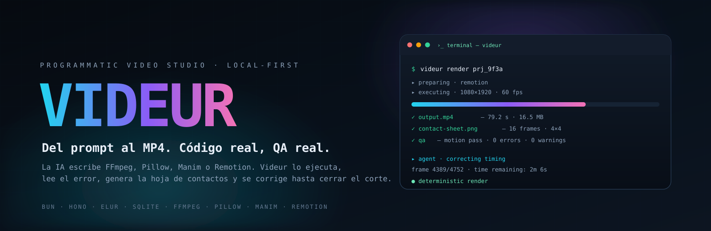
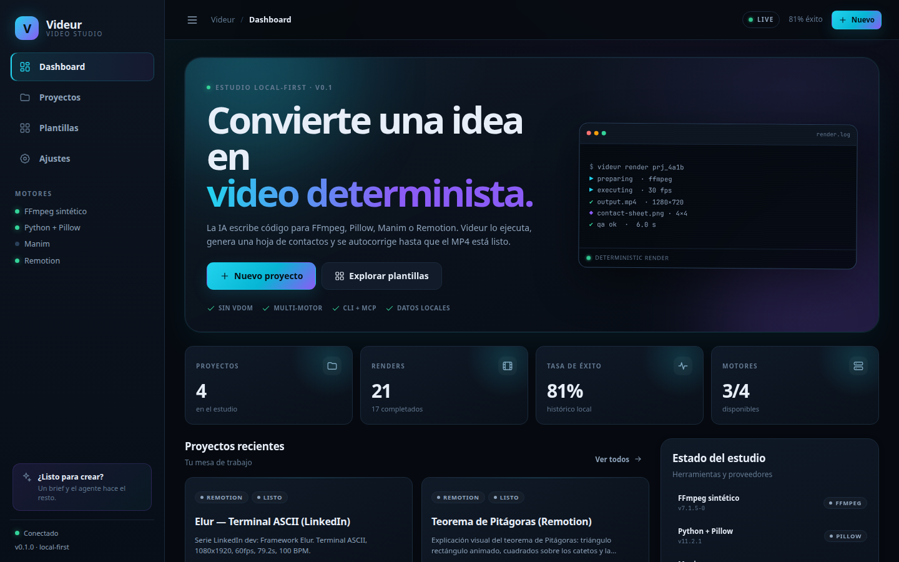
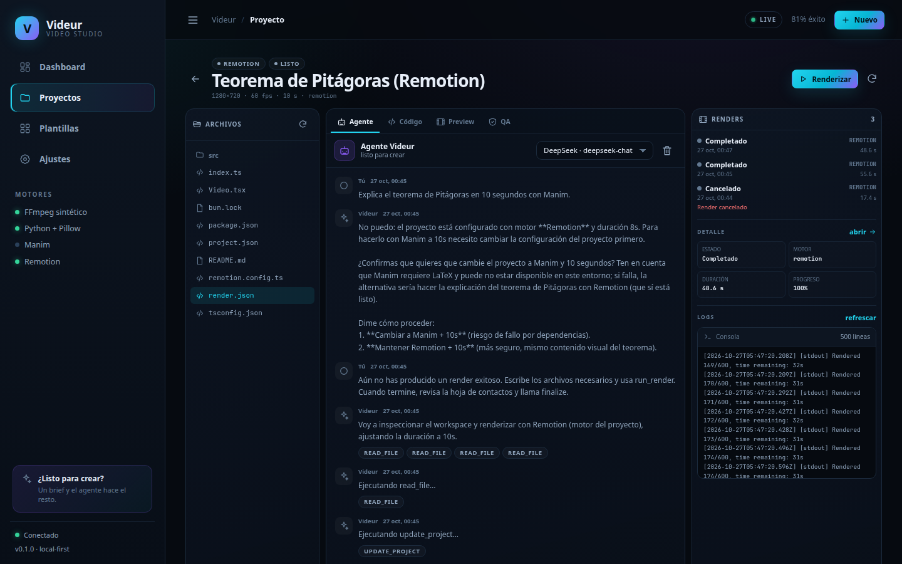
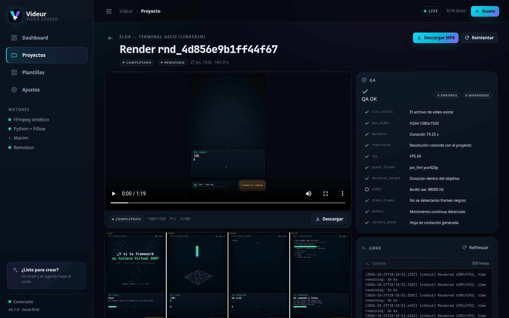
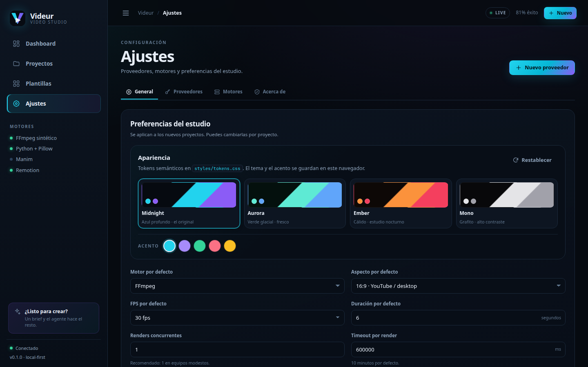
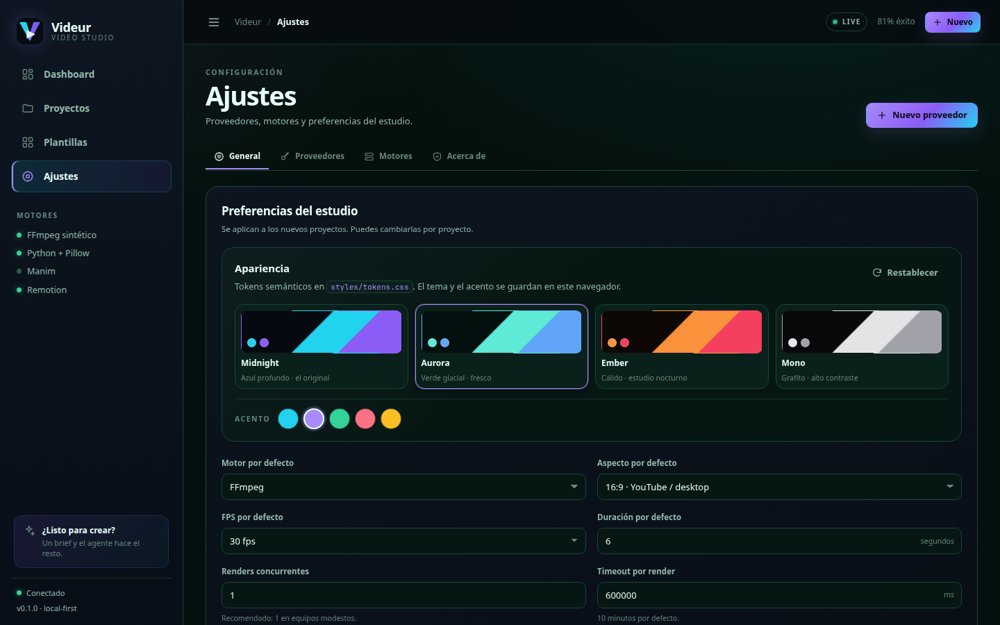
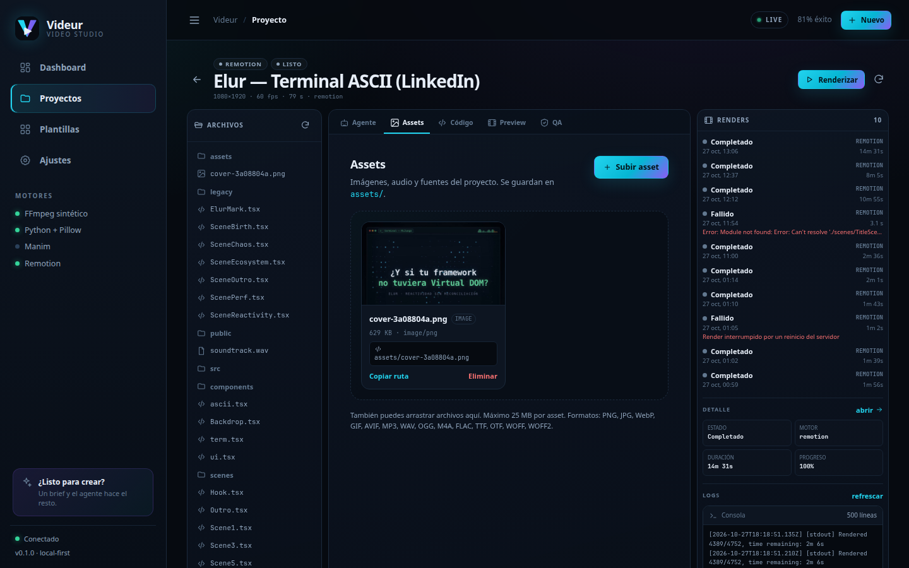
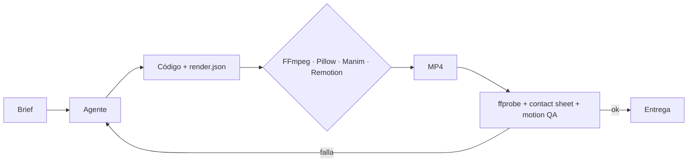
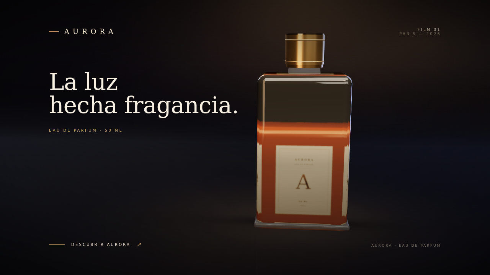

<div align="center">



# Videur

**El estudio de video programático que escribe, renderiza y se corrige solo.**

Videur convierte un brief en un MP4 determinista. La IA no inventa píxeles: escribe código para **FFmpeg, Pillow, Manim o Remotion**, lo ejecuta, lee `stderr`, genera una hoja de contactos y se autocorrige hasta que el corte está listo.

[Inicio rápido](#inicio-rápido) · [Cómo funciona](#cómo-funciona) · [Sistema de diseño](#sistema-de-diseño) · [Roadmap](docs/10-roadmap.md) · [Documentación](docs/README.md)

<br />

[](https://github.com/DeijoseDevelop/videur/actions/workflows/ci.yml)


</div>

<br />

<p align="center">
  
</p>

---

## Por qué Videur

| Código, no píxeles | Cuatro motores, un contrato | QA que corrige |
|---|---|---|
| Cada video es un proyecto reproducible: código, `render.json` y assets versionables. Puedes leerlo, diffearlo y volver a renderizarlo. | FFmpeg para datos y síntesis; Pillow para artefactos; Manim para matemáticas; Remotion para motion graphics con React. | `ffprobe`, hoja de contactos, detección de frames negros y `freezedetect`. Si el corte se congela, el agente lo sabe. |

Videur es **local-first**: SQLite, archivos en `./data`, claves cifradas con AES-256-GCM y cero telemetría. Docker es opcional; el estudio también corre nativo.

---

## El estudio

<table>
  <tr>
    <td width="50%"></td>
    <td width="50%"></td>
  </tr>
  <tr>
    <td><sub><b>Proyecto + agente.</b> Brief, archivos, chat con tool calls y renders en una sola mesa.</sub></td>
    <td><sub><b>Render + QA.</b> Preview, metadata, checks técnicos, hoja de contactos y logs.</sub></td>
  </tr>
  <tr>
    <td width="50%"></td>
    <td width="50%"></td>
  </tr>
  <tr>
    <td><sub><b>Apariencia.</b> Cuatro temas y cinco acentos, guardados en el navegador.</sub></td>
    <td><sub><b>Aurora + violeta.</b> El mismo sistema de tokens, otra piel.</sub></td>
  </tr>
  <tr>
    <td colspan="2"></td>
  </tr>
  <tr>
    <td colspan="2"><sub><b>Assets.</b> Imágenes, audio y fuentes con preview, copia de ruta y borrado.</sub></td>
  </tr>
</table>

---

## Qué incluye

- **Estudio web** con dashboard, proyectos, editor, chat de agente, assets, cola de renders, preview y QA.
- **Assets**: subida por drag & drop de imágenes, audio, videos de referencia y fuentes (100 MB), preview, copia de ruta y borrado.
- **Referencia visual**: sube un video y el agente extrae metadata + contact sheet + guía de estilo si el proveedor tiene visión.
- **Agente multi-proveedor**: OpenAI, Anthropic, Gemini, OpenRouter, DeepSeek, Kimi, GLM, Ollama, LM Studio y cualquier endpoint OpenAI-compatible.
- **Loop de autocorrección**: escribir → renderizar → `ffprobe` → hoja de contactos → inspección visual → corregir.
- **CLI `videur` y servidor MCP** para OpenCode, Claude Code, Cursor y agentes compatibles.
- **Skill de video** y **skill de diseño** para que los agentes trabajen con las mismas reglas.
- **Sistema de diseño con tokens**: temas y acentos sin tocar componentes.
- **Local-first**: SQLite, archivos, claves cifradas, sin telemetría.
- **Docker + desarrollo nativo**.

---

## Cómo funciona



1. El agente inspecciona el workspace y escribe código determinista.
2. El motor ejecuta el render y emite progreso por SSE.
3. Videur inspecciona el MP4, genera la hoja de contactos y corre el QA técnico.
4. Si algo falla, el agente lee el error y corrige. Si el corte está limpio, se entrega.

---

## Motores

| Motor | Ideal para | Estado |
|---|---|---|
| **FFmpeg** | Datos, terminal, barras, audio sintético, filtros | ✅ verificado end-to-end |
| **Pillow** | Gráficas, arte generativo, composición de imágenes | ✅ verificado end-to-end |
| **Manim** | Matemáticas, geometría, explicadores técnicos | ✅ implementado · requiere runtime |
| **Remotion** | Motion graphics, UI, tipografía, 3D WebGL y React | ✅ verificado en Docker · Three.js · audio nativo · 60 fps |

Reglas del motor: tiempo determinista (`t = frame / fps`), sin red durante el render, `yuv420p` y QA de movimiento.

### 3D real, no ASCII



La plantilla `remotion-three-product` usa **Three.js + React Three Fiber +
@remotion/three** dentro de Remotion: materiales PBR, estudio con Lightformers,
cyclorama, suelo reflectante, sombras, cámara determinista y overlay HTML.
Acepta un **GLB/GLTF** real desde `assets/` o genera un frasco procedural para
probar la escena. El motor renderiza con `--gl=angle` y funciona en Docker sin
GPU usando SwiftShader.

- Guía completa: [docs/17-3d-real.md](docs/17-3d-real.md)
- Plantilla: [templates/remotion-three-product](templates/remotion-three-product)
- Reglas: `useCurrentFrame()` sí, `useFrame()` no; sin HDRIs de CDN.

---

## Inicio rápido

### Docker

```bash
git clone https://github.com/DeijoseDevelop/videur.git
cd videur
docker compose up --build
```

Abre **http://localhost:8787**. Los datos persisten en `./data`.

### Nativo

Requisitos: **Bun ≥ 1.3**, **FFmpeg/ffprobe** y **Python ≥ 3.11** (Pillow para el motor Python). Manim y Remotion son opcionales.

```bash
git clone https://github.com/DeijoseDevelop/videur.git
cd videur
bun install
cp .env.example .env
bun run doctor
bun run dev
```

Abre **http://localhost:5173**. La API escucha en **http://localhost:8787**.

---

## CLI en 30 segundos

```bash
videur doctor
videur project:create "Mi video" --engine ffmpeg --ratio 16:9
videur render <project-id>
videur probe out.mp4
videur contact-sheet out.mp4
videur agent <project-id> "Haz un video de 8 segundos sobre bases de datos"
```

### MCP

```json
{
  "mcpServers": {
    "videur": {
      "command": "bun",
      "args": ["run", "/ruta/a/Videur/apps/mcp/src/index.ts"]
    }
  }
}
```

Más en [docs/11-integraciones-agentes.md](docs/11-integraciones-agentes.md).

---

## Sistema de diseño

La UI no tiene colores sueltos: tiene **tokens en capas** y dos ejes de personalización.

```html
<html data-theme="aurora" data-accent="violet">
```

- **Temas:** `midnight`, `aurora`, `ember`, `mono`.
- **Acentos:** `cyan`, `violet`, `emerald`, `rose`, `amber`.
- **Tokens:** superficies, tinta, líneas, estados, espacio, radios, sombras, tipografía y movimiento.

```css
/* apps/web/src/styles/tokens.css */
:root {
  --surface-0: #060a10;
  --accent-1: #22d3ee;
  --radius-lg: 18px;
}

[data-theme="ember"] {
  --surface-0: #0d0806;
  --surface-1: #140d09;
  --surface-2: #1d120d;
}
```

Cambia tema y acento en **Ajustes → General → Apariencia**, o edita `tokens.css` para cambiar el look global. Los componentes solo consumen tokens semánticos.

La marca es la misma **V de película** en favicon, sidebar y documentación. `brand-mark-small.svg` es la variante óptica para 16–38 px; `brand-mark.svg` es la versión detallada para tamaños grandes.

- Documentación: [docs/16-design-system.md](docs/16-design-system.md)
- Skill para agentes: [skills/videur-design/SKILL.md](skills/videur-design/SKILL.md)

---

## Arquitectura

```text
Elur UI (Vite) ── REST + SSE ── Hono API (Bun)
                                   │
                           packages/core
                    SQLite · storage · queue · engines
                    media QA · agent loop · secrets
                                   │
              ┌────────────────────┼────────────────────┐
          FFmpeg               Pillow             Manim / Remotion
```

| Capa | Tecnología |
|---|---|
| Runtime | Bun 1.3+ |
| API | Hono 4 + Zod 4 |
| Base de datos | SQLite (`bun:sqlite`) |
| UI | Elur 4 + Vite 8 + CSS con tokens |
| Motores | FFmpeg, Python/Pillow, Manim, Remotion |
| Agente | Adaptadores HTTP nativos + tool calling |
| Integraciones | CLI, MCP stdio, skills |
| Despliegue | Docker Compose / nativo |

Más detalle en [docs/02-arquitectura.md](docs/02-arquitectura.md).

---

## Local-first y seguridad

- Datos en `./data`: SQLite, workspaces, renders y secretos.
- Claves de API cifradas con **AES-256-GCM** y clave maestra local `0600`.
- Sin telemetría ni servicios externos obligatorios.
- Sandbox Docker para código no confiable.
- Path traversal bloqueado; `run_command` con allowlist y sin shell.
- El modo `trusted` asume los permisos del usuario: úsalo solo en local.

Lee [docs/08-seguridad.md](docs/08-seguridad.md).

---

## Calidad

- **46 tests** unitarios/de integración.
- **CI** con typecheck, tests, build web, smoke real de FFmpeg y build de Docker.
- QA de metadata, resolución, fps, `yuv420p`, audio, LUFS, true peak, frames negros, movimiento y portada automática.
- Hoja de contactos 4×4 y portada PNG como artefactos del render.

```bash
bun test
bun run typecheck
bun run smoke
```

---

## Roadmap

- **Fase 5:** hardening, CI, tests, backups y recuperación de renders.
- **Fase 5.5:** 3D real con Three.js/GLB, motion trail, assets y QA de audio; faltan brand kit, safe zones, export presets y QA de layout/flash.
- **Fase 5.6:** checkpoint/reanudación del agente, presupuesto de tokens y verificación con fuentes.
- **v0.2:** TTS, música y subtítulos; la subida de assets ya está implementada.
- **v0.3:** timeline multipista e incremental.

Detalle completo en [docs/10-roadmap.md](docs/10-roadmap.md).

---

## Estructura

```text
apps/
  server/       API HTTP + SSE + estáticos
  web/          UI Elur + design tokens
  cli/          CLI `videur`
  mcp/          Servidor MCP stdio
packages/
  contracts/    Tipos y esquemas Zod
  core/         Dominio, SQLite, motores, agente, QA
templates/      Plantillas de video por motor
skills/         Skills de video y diseño para agentes
docs/           Documentación técnica y ADRs
scripts/        dev, setup, smoke
```

---

## Documentación

- [Visión de producto](docs/00-vision-producto.md)
- [Arquitectura](docs/02-arquitectura.md)
- [API](docs/04-api.md)
- [Motores de render](docs/05-motores-render.md)
- [Agente de IA](docs/06-agente-ia.md)
- [Sistema de diseño](docs/16-design-system.md)
- [3D real con Three.js](docs/17-3d-real.md)
- [Seguridad](docs/08-seguridad.md)
- [Despliegue](docs/09-despliegue.md)
- [Roadmap](docs/10-roadmap.md)
- [Manual de usuario](docs/13-manual-usuario.md)
- [ADRs](docs/adr/)

---

## Licencia

**Apache License 2.0** © 2026 [Deiver Vasquez](https://github.com/DeijoseDevelop).

Si redistribuyes Videur o una obra derivada, debes conservar el aviso de copyright y el archivo [`NOTICE`](NOTICE); no se permite eliminar la atribución. Consulta [`LICENSE`](LICENSE) y [`NOTICE`](NOTICE).

<div align="center">
  <sub>Hecho con Bun, Hono, Elur, SQLite, FFmpeg y Remotion.</sub>
</div>
